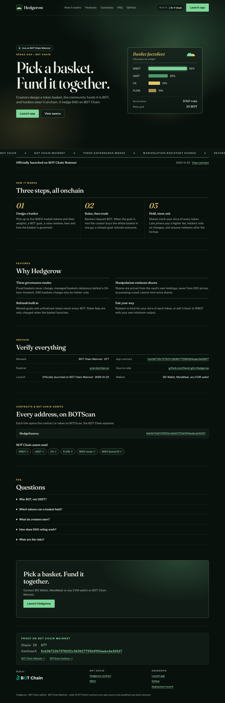

# Hedgerow

**Pick a basket. Fund it together.** Creators design a token basket, the community funds it in BOT, and holders steer it onchain. A hedge DAO on BOT Chain.

**Officially launched on BOT Chain Mainnet** on 2026-10-22.

- Website and app: https://hedgerowbot.vercel.app (app at [`/app/`](https://hedgerowbot.vercel.app/app/))
- Network: BOT Chain mainnet, chain ID 677 · [BOT Chain](https://www.botchain.ai/) · [BOTScan](https://scan.botchain.ai/)



## How it works

1. **Design a basket.** Pick up to five BDEX-traded tokens and their weights, a BOT goal, a raise window, fees and how the basket is governed.
2. **Raise, then trade.** Backers deposit BOT. When the goal is met the creator buys the whole basket in one go; a missed goal refunds everyone.
3. **Hold, steer, exit.** Shares track your slice of every token. Late joiners pay a higher fee, holders vote on changes, and anyone redeems after the lockup.

## Features

- **Three governance modes.** Fixed baskets never change, managed baskets rebalance behind a 24-hour timelock, DAO baskets change only by holder vote.
- **Manipulation-resistant shares.** Shares are priced from the vault's own holdings, never from DEX prices, so pumping a pool cannot mint extra shares.
- **Refunds built in.** Missed goals and unfinalized raises return every BOT. Raise fees are only charged when the basket launches.
- **Exit your way.** Redeem in kind for your slice of each token, or sell it back to WBOT with your own minimum output.

## Contracts

| Contract | BOT Chain mainnet |
|---|---|
| `HedgeFactory` | [`0xb36712b7378ff1c5636177556f954aabc6ef65f7`](https://scan.botchain.ai/address/0xb36712b7378ff1c5636177556f954aabc6ef65f7) |

BOT Chain infrastructure used: USDT `0xaBabc7Ddc03e501d190C676BF3d92ef0e6e87a3C`, WBOT `0xD5452816194a3784dBa983426cCe7c122F4abd30`, BDEX router `0x07032d47A1b9f8460cBeE9dC17c1d3E438693929`, BDEX QuoterV2 `0x034A705b36067cff99ABf5C662Be881cBd8d0176`.

Source: [`contracts/src`](contracts/src). Tests: [`contracts/test`](contracts/test). The contracts are unaudited; use small amounts.

## Develop

Requires Node 20+, [Foundry](https://getfoundry.sh) and Python 3.

```bash
git clone --recursive https://github.com/David-glitc/hedgerow.git
cd hedgerow
npm ci
npm test              # forge test
npm run build         # landing page + app into dist/hedgerow
npm run preview       # http://127.0.0.1:8771
```

`npm run build` writes `dist/hedgerow/index.html` (landing page), `dist/hedgerow/app/` (the dApp) and a Cloudflare Workers bundle under `sites/`.

### Wallets

The app discovers installed wallets with EIP-6963 (BO Wallet, MetaMask, OKX, Rabby and others) and falls back to `window.ethereum`. It switches or adds BOT Chain (chain ID `0x2a5`, RPC `https://rpc.botchain.ai`) before any transaction, and simulates every call before asking for a signature.

### Rehearse on a mainnet fork

```bash
anvil --fork-url https://rpc.botchain.ai --port 8677 --chain-id 677
export BOT_RPC_URL=http://127.0.0.1:8677
node scripts/deploy.mjs && node scripts/fork-check.mjs
```

### Deploy

`scripts/deploy.mjs` reads the deployer key from `BOT_SIGNER_FILE` (default `~/.config/botchain-wave1/deployer.env`, never committed), refuses to broadcast on mainnet without `BOT_MAX_GAS_BOT`, and journals every transaction to `deployments/mainnet.json` so it can resume. `npm run publish` deploys the built site to Vercel as a static production deployment.

## License

MIT. Built on [BOT Chain](https://www.botchain.ai/).
